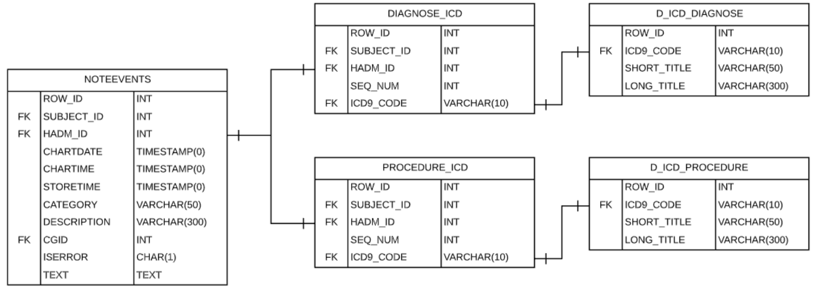
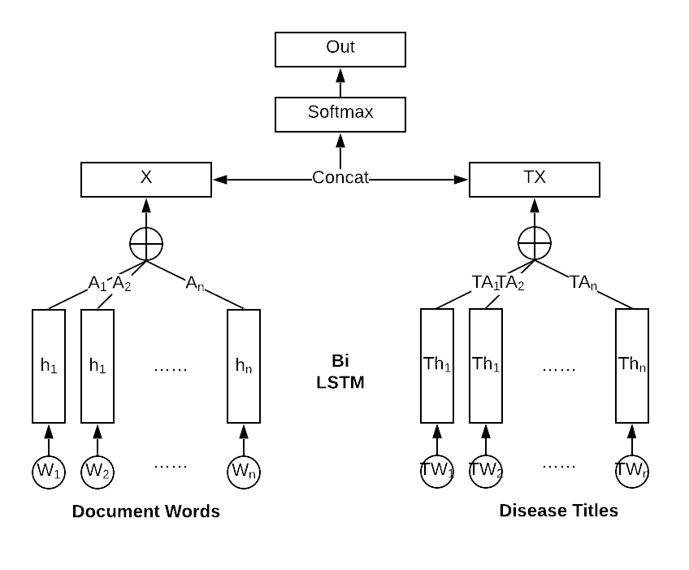
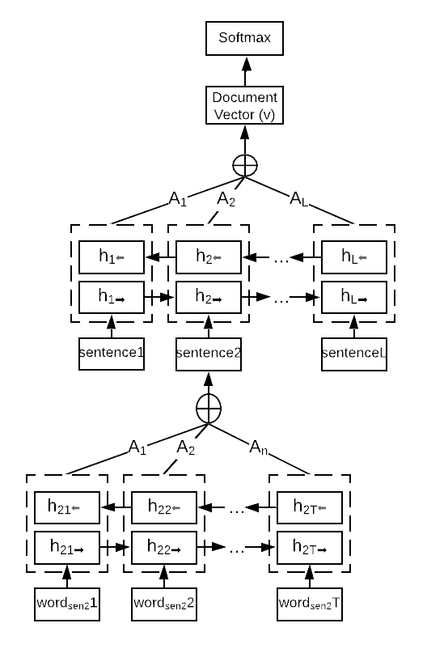

# ICD-9 Code Prediction from Clinical Notes

Predicting Medical Billing Codes (ICD-9) from Clinical Notes in MIMIC-III using Deep Learning.

[](https://www.python.org/downloads/)
[](https://pytorch.org/)
[](https://opensource.org/licenses/MIT)

## Overview

This project implements multiple deep learning models for automatic ICD-9 code prediction from clinical notes. Given a patient's clinical documentation, the models predict relevant diagnostic codes to assist with medical billing and clinical decision support.

### Key Features

- **5 Model Architectures**: SLSTM, CLSTM, HAN, Hierarchical Self-Attention, and Fine-tuned ClinicalBERT
- **Comprehensive Preprocessing**: Clinical note section extraction, tokenization, and ICD code hierarchy mapping
- **Multi-label Classification**: Predicts multiple ICD-9 codes per clinical note
- **Evaluation Metrics**: Macro-F1, Micro-F1, Precision@N

## Table of Contents

- [Installation](#installation)
- [Quick Start](#quick-start)
- [Data Setup](#data-setup)
- [Models](#models)
- [Usage](#usage)
- [Evaluation](#evaluation)
- [Project Structure](#project-structure)
- [Testing](#testing)
- [Contributing](#contributing)
- [Authors](#authors)
- [License](#license)

## Installation

### Prerequisites

- Python 3.8 or higher
- CUDA-capable GPU (recommended for training)
- Access to MIMIC-III dataset (requires credentialing)

### Setup

1. **Clone the repository**
   ```bash
   git clone https://github.com/ziyuqiu/icd_prediction.git
   cd icd_prediction
   ```

2. **Create a virtual environment**
   ```bash
   python -m venv venv
   source venv/bin/activate  # On Windows: venv\Scripts\activate
   ```

3. **Install dependencies**
   ```bash
   pip install -r requirements.txt
   ```

4. **Download NLTK data**
   ```python
   import nltk
   nltk.download('punkt')
   nltk.download('stopwords')
   ```

## Quick Start

```python
# Example: Load preprocessed data and run inference
import pickle
import torch

# Load preprocessed data
with open('data/test_tensor.pkl', 'rb') as f:
    X_test, y_test, ids_test = pickle.load(f)

# Load trained model
model = torch.load('model_checkpoint.ckpt')
model.eval()

# Run prediction
with torch.no_grad():
    predictions = model(X_test)
```

## Data Setup

### MIMIC-III Access

This project uses the [MIMIC-III](https://mimic.physionet.org/) dataset. To obtain access:

1. Complete the CITI training course
2. Sign the Data Use Agreement on PhysioNet
3. Download the following tables:
   - `NOTEEVENTS.csv` - Clinical notes
   - `DIAGNOSES_ICD.csv` - ICD-9 diagnosis codes
   - `D_ICD_DIAGNOSES.csv` - ICD-9 code descriptions
   - `ADMISSIONS.csv` - Hospital admissions

### Data Schema



### Preprocessing Pipeline

Run the preprocessing notebooks in order:

```bash
# 1. Extract and transform data
jupyter notebook Preprocess/data_processing.ipynb

# 2. Process note sections
jupyter notebook Preprocess/note_sections.ipynb

# 3. Map ICD codes to hierarchical levels
jupyter notebook Preprocess/high_lvl_codes.ipynb
```

**Expected Output Files:**
- `data/train_tensor.pkl` - Training data (X, y, ids)
- `data/dev_tensor.pkl` - Validation data
- `data/test_tensor.pkl` - Test data
- `data/word2index.pkl` - Vocabulary mapping
- `data/mlb.pkl` - MultiLabelBinarizer for ICD codes

## Models

### 1. LSTM Models (SLSTM & CLSTM)

Bidirectional LSTM with attention mechanisms for word-level encoding.

| Model | Description |
|-------|-------------|
| SLSTM | Self-Attention LSTM (baseline) |
| CLSTM | Codes Attentive LSTM with disease title embeddings |



**Training:**
```bash
jupyter notebook LSTM/LSTM.ipynb
```

### 2. Hierarchical Attention Network (HAN)

Two-level attention (word → sentence → document) for capturing document hierarchy.



**Training:**
```bash
jupyter notebook HAN/HAN.ipynb
```

### 3. ClinicalBERT

Fine-tuned [ClinicalBERT](https://github.com/EmilyAlsentzer/clinicalBERT) for multi-label classification.

**Configuration:**
- Vocabulary: 28,996 tokens
- Embedding dimension: 768
- Max sequence length: 512
- Batch size: 8
- Gradient clipping: [-14.0, 14.0]

**Training:**
```bash
cd BERT
python model.py
```

**Evaluation:**
```bash
python BERT/evaluate.py --model_path model_checkpoint.ckpt
```

## Usage

### Training a Model

```python
from BERT.model import ClinicBertMultiLabelClassifier
import pytorch_lightning as pl

# Initialize model
model = ClinicBertMultiLabelClassifier()

# Train
trainer = pl.Trainer(max_epochs=100, gpus=1)
trainer.fit(model)
```

### Making Predictions

```python
import torch
from transformers import AutoTokenizer

# Load model
checkpoint = torch.load('model_checkpoint.ckpt')
model.load_state_dict(checkpoint['model'])
model.eval()

# Tokenize input
tokenizer = AutoTokenizer.from_pretrained("emilyalsentzer/Bio_ClinicalBERT")
inputs = tokenizer("Patient presents with chest pain...",
                   max_length=512,
                   padding='max_length',
                   return_tensors='pt')

# Predict
with torch.no_grad():
    probs = model(inputs['input_ids'])
    predicted_codes = (probs > 0.5).int()
```

## Evaluation

### Metrics

| Metric | Description |
|--------|-------------|
| Micro-F1 | Global F1 across all labels |
| Macro-F1 | Average F1 per label |
| Precision@8 | Precision for top 8 predictions |
| Precision@15 | Precision for top 15 predictions |

### Running Evaluation

```bash
python BERT/evaluate.py \
    --model_path checkpoints/best_model.ckpt \
    --test_data data/test_tensor.pkl
```

## Project Structure

```
icd_prediction/
├── BERT/
│   ├── model.py          # ClinicalBERT classifier
│   ├── evaluate.py       # Evaluation script
│   ├── utils.py          # BERT utilities
│   └── plot.ipynb        # Training visualization
├── LSTM/
│   ├── LSTM.ipynb        # SLSTM and CLSTM models
│   └── util.py           # Data utilities
├── HAN/
│   └── HAN.ipynb         # Hierarchical Attention Network
├── Preprocess/
│   ├── data_processing.ipynb    # ETL from MIMIC-III
│   ├── note_sections.ipynb      # Text preprocessing
│   ├── high_lvl_codes.ipynb     # ICD code mapping
│   └── heuristic_tokenize.py    # Sentence tokenization
├── tests/
│   ├── conftest.py       # Shared fixtures
│   └── unit/             # Unit tests
├── imgs/                 # Architecture diagrams
├── requirements.txt      # Dependencies
├── pytest.ini           # Test configuration
└── README.md
```

## Testing

### Running Tests

```bash
# Run all tests with coverage
pytest

# Run specific test file
pytest tests/unit/test_heuristic_tokenize.py

# Run with verbose output
pytest -v --cov-report=term-missing
```

### Test Coverage Target

This project maintains **80%+ test coverage**. Coverage reports are generated automatically:

```bash
# Generate HTML coverage report
pytest --cov-report=html
open htmlcov/index.html
```

## Contributing

1. Fork the repository
2. Create a feature branch (`git checkout -b feature/amazing-feature`)
3. Write tests for new functionality
4. Ensure all tests pass (`pytest`)
5. Commit your changes (`git commit -m 'feat: add amazing feature'`)
6. Push to the branch (`git push origin feature/amazing-feature`)
7. Open a Pull Request

### Code Style

- Follow PEP 8 guidelines
- Use type hints where possible
- Write docstrings for public functions
- Keep functions small and focused

## Authors

- **Ziyu (Andrea) Qiu** - [@ziyuqiu](https://github.com/ziyuqiu) - zq64@cornell.edu
- **Yezhou (Yeats) Ma** - [@YeatsMar](https://github.com/YeatsMar) - ym462@cornell.edu
- **Jingxuan (Kelly) Sun** - [@shakingkelly](https://github.com/shakingkelly) - js3422@cornell.edu
- **Ta-Wei (David) Mao** - [@davidmao8419](https://github.com/davidmao8419) - tm592@cornell.edu
- **Yixue Wang** - [@yw2224](https://github.com/yw2224) - yw2224@cornell.edu

## License

This project is licensed under the MIT License - see the [LICENSE](LICENSE) file for details.

## Acknowledgments

- [MIMIC-III](https://mimic.physionet.org/) dataset from PhysioNet
- [ClinicalBERT](https://github.com/EmilyAlsentzer/clinicalBERT) pre-trained model
- Cornell University CS5787 Deep Learning course

## Citation

If you use this code in your research, please cite:

```bibtex
@misc{icd_prediction,
  author = {Qiu, Ziyu and Ma, Yezhou and Sun, Jingxuan and Mao, Ta-Wei and Wang, Yixue},
  title = {Predicting Medical Billing Codes from Clinical Notes using Deep Learning},
  year = {2020},
  publisher = {GitHub},
  url = {https://github.com/ziyuqiu/icd_prediction}
}
```
